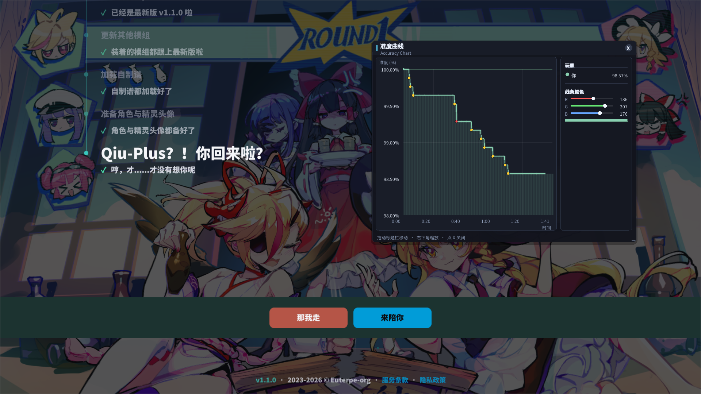
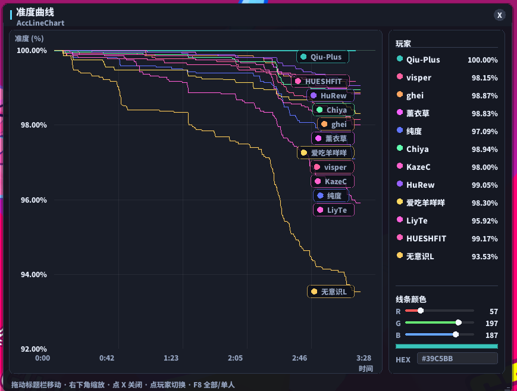

# AccLineChart

Muse Dash 准度曲线模组（MelonLoader）。单人打完一首歌后在结算页显示可拖动、可缩放的准度曲线；安装 Euterpe 进入多人房间后，实时显示房间内所有玩家的准度曲线、昵称与头像。



## 功能

- **单人准度曲线**：结算页自动弹出，从 100% 出发，Great（黄点）/ Miss（红菱形）标出下降点；
- **多人实时曲线**：进入 Euterpe 多人房间后，实时显示所有玩家的准度曲线（数据来自游戏自身 Euterpe 连接，不建立额外连接、不影响联机）；
- **多人结算**：每回合结束自动弹出面板，显示昵称、头像、Roboko 评级和服务器官方最终准确率；
- **端点头像昵称标签**：每条曲线末端跟随显示该玩家的头像与昵称；
- **视图切换**：F8 在「全部玩家 / 只看选中玩家」之间切换，点击或悬停右侧玩家列表切换查看对象；
- **玩家列表滚动**：房间人数较多时可用鼠标滚轮上下滚动，带滚动条；
- **HEX 取色**：可用 RGB 滑条或 HEX 输入框（`#RRGGBB` / `RRGGBB` / `#RGB`）调整自己的线条颜色；
- **窗口操作**：按住窗口任意位置拖动移动、右下角缩放、点 X 关闭，位置/大小/颜色自动保存；
- **输入隔离**：窗口上的点击/拖动/滚轮不会传给游戏（后面的选曲界面、按钮不会被误触），鼠标移出窗口后游戏输入立刻恢复正常；
- **F9 预览**：主界面按 F9 打开假数据预览窗口，方便调整布局和配色；
- **性能优化**：曲线光栅化到缓存纹理，多人房同时显示 10+ 条实时曲线也不会明显掉帧。

多人联机（10 人房间实时曲线，曲线末端跟随昵称，右侧玩家列表显示头像/昵称/最终准确率）：



## 环境要求

- Muse Dash（Steam 版，开发时基于 6.8.0）
- [MelonLoader](https://github.com/LavaGang/MelonLoader) 0.7.3+（.NET 6）
- 多人实时功能需要安装 [Euterpe](https://euterpe-org.com/) 并联机
- 构建源码需要 .NET 10 SDK（项目目标框架仍是 `net6.0`）

## 安装

1. 把 `AccLineChart.dll` 放进游戏目录的 `Mods` 文件夹即可（**单文件发布**，无额外依赖：进程内 Hook 使用 MelonLoader 自带的 Iced 解码器手写的轻量 detour，不内嵌任何 Hook 库）；
2. 可选：`UserLibs` 中若有 `SkiaSharp.dll` 与 `libSkiaSharp.dll`（很多现代模组会自带），多人玩家头像会自动显示；没有则用颜色圆点代替；
3. 重启游戏。

## 使用说明

### 单人
正常游玩一首歌，结算页会自动弹出准度曲线窗口。曲线从 100% 起算，Great 为黄点、Miss 为红菱形，终点与游戏结算准度一致。

### 多人联机
安装 Euterpe 并进入多人房间。当房间内有其他玩家时，模组会从游戏自身的 Euterpe WebSocket 连接读取服务器广播的实时成绩帧，实时绘制所有玩家的准度曲线；房间只有自己时只显示自己的数据，进入多人大厅/房间后自动生效。

- 每回合结束会自动弹出面板；对手没有实时数据时，以服务器官方最终准确率显示一条带 `≈` 的近似线；
- 面板右侧「玩家」列表显示头像、昵称和最终准确率，点击或悬停可只看该玩家；F8 切换全部/单人视图；
- 玩家多时鼠标滚轮滚动列表。

### 快捷键与窗口
- `F8`：全部玩家 / 只看选中玩家；
- `F9`：打开/关闭预览窗口（主界面可用；有多人真实数据时优先显示真实数据）；
- 按住窗口任意位置拖动移动、右下角缩放、右上角 X 关闭；
- 玩家列表用鼠标滚轮滚动（拖动窗口时不会误滚列表）；
- 窗口位置、大小、颜色保存在 `UserData/AccLineChart.cfg`。

### 颜色
右侧侧边栏可拖动 R/G/B 滑条，或在 HEX 输入框中点击后输入 `#RRGGBB`、`RRGGBB` 或 `#RGB`，回车应用、Esc 取消。

## 配置

配置文件：`UserData/AccLineChart.cfg`（MelonPreferences）

| 项 | 说明 |
|---|---|
| `LineColorR/G/B` | 线条颜色（0~1） |
| `LineColorHex` | 线条颜色（HEX，与 RGB 滑条同步） |
| `WindowX/Y/W/H` | 窗口位置和大小 |
| `ShowPerfectDots` | 是否用小白点标注 Perfect（默认关） |
| `DebugLog` | 调试日志（默认关） |
| `MultiplayerTap` | 是否读取 Euterpe 联机数据（默认开；只读，不额外连接） |
| `MultiplayerLive` | 实验性网页观战连接（默认关；开启可能让游戏重连） |
| `MpNetworkDiagnostics` | 网络诊断日志（默认关） |

## 联机数据来源与隐私

- 模组在**游戏进程内**读取 Euterpe 自己收到的 31 字节实时成绩帧（uid、谱面时间、分数、准确率、判定数等），不建立额外连接、不登录、不修改游戏或 Euterpe 文件；
- 游戏与 Euterpe 的连接、行为完全不受影响，不会出现「联机断开/重连」弹窗；
- 只读取当前房间公开显示的数据，不扫描房间、不收集他人信息到外部；
- 不读写 `_game` 存档，只写自己的配置文件。

## 构建

项目使用 [MuseDash.Mod.Template](https://www.nuget.org/packages/MuseDash.Mod.Template) 的 MSBuild SDK：`MuseDash.Mod.Sdk` 会自动在 Steam 库中查找游戏，引用 MelonLoader 与游戏程序集，并在每次构建后把 DLL 复制到游戏的 `Mods` 目录。

```powershell
cd src
dotnet build -c Release
```

如果游戏不在 Steam 默认库中，设置环境变量 `MD_DIRECTORY` 指向游戏目录，或在项目旁创建 `AccLineChart.csproj.user`：

```xml
<Project>
  <PropertyGroup>
    <GameFolder>D:\Games\Muse Dash</GameFolder>
  </PropertyGroup>
</Project>
```

构建产物：`artifacts/bin/AccLineChart/release/AccLineChart.dll`

可选：设置 `MD_DEPLOY_DIR` 可把构建结果额外复制到指定目录。

## 更新日志

见 [docs/CHANGELOG.md](docs/CHANGELOG.md)。

## 许可与第三方组件

- 本仓库代码以 [MIT](LICENSE) 协议发布；
- 运行时不需要额外第三方库（Hook 仅使用 MelonLoader 随附的 Iced 解码器，不随模组分发），详见 [THIRD-PARTY-NOTICES.md](THIRD-PARTY-NOTICES.md)；
- 本仓库不包含、不修改 Euterpe 或 Muse Dash 的任何文件。

## 第三方组件

- 进程内 Hook 是自写的轻量 x64 detour（VirtualProtect/VirtualAlloc + `Iced` 指令解码重定位），只使用 MelonLoader 自带的 `Iced.dll`，不内嵌、不分发任何 Hook 库；
- 多人玩家头像的 WebP 解码会使用游戏中已存在的 SkiaSharp（若存在），未内嵌。

## 作者

巯_QiuPlus
